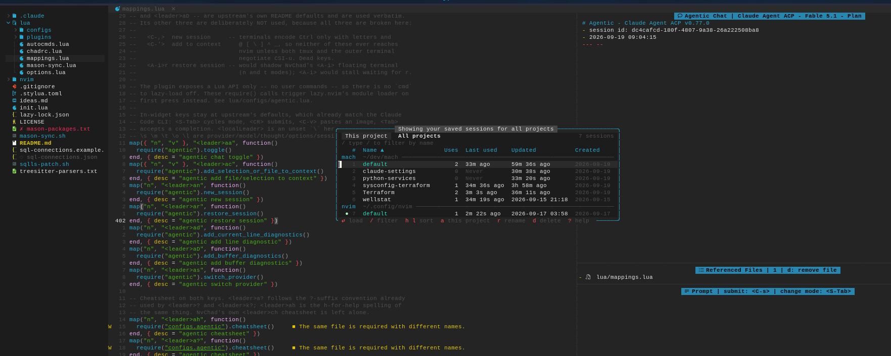

# session-mgr.nvim

Named, per-project Neovim sessions with a floating picker.

Save as many sessions per project as you like, load them from a sortable,
filterable, mouse-friendly popup, and keep a one-keystroke `default` session
for the lazy case. Sessions are keyed by **git root**, so they load from
anywhere inside the repo; every session carries a use count and
last-used / updated / created times.



```
╭────────────── Save session for work ───────────────╮   <leader>ss
│cooli.vim                                           │   the .vim is always shown, never editable
╰────────────────────────────── overwrites cooli.vim ╯   tells you before you press Enter
╭──────────────── 3 of 5 saved for work ─────────────╮
│   cool                                  3h 20m ago │   narrows as you type
│ ▌ cooli                                 4h 26m ago │   Tab cycles matches into the input
╰ ⏎ save  tab complete  esc cancel ──────────────────╯
```

## Contents

- [Requirements](#requirements)
- [Install](#install)
- [Quick start](#quick-start)
- [Commands](#commands)
- [Autosave](#autosave)
- [Processes tab](#processes-tab)
- [Keymaps](#keymaps)
- [Configuration](#configuration)
- [How projects and sessions are identified](#how-projects-and-sessions-are-identified)
- [Data on disk](#data-on-disk)
- [Highlight groups](#highlight-groups)
- [Events and hooks](#events-and-hooks)
- [Troubleshooting](#troubleshooting)
- [Development](#development)

## Requirements

- Neovim **0.11+** (developed on 0.12). Uses float titles/footers, inline
  virtual text, `vim.system`, `vim.uv`, `vim.fs`.
- `git` (optional): without it every directory is its own project.
- No plugin dependencies.

## Install

This is a private repo developed in `~/dev/session-mgr.nvim`. lazy.nvim loads
that checkout directly, and only clones from GitHub (which needs
`gh auth setup-git`, because lazy runs git with prompts disabled) when the
checkout is missing.

```lua
-- lua/configs/lazy.lua  (lazy's own options)
dev = { path = "~/dev", fallback = true },   -- fallback is OFF by default in lazy

-- lua/plugins/session-mgr.lua
return {
  {
    "hosua/session-mgr.nvim",
    dev = true,
    cmd = { "SessionMgr" },   -- the load trigger; the keymaps below ride it
    event = "VeryLazy",       -- so autosave runs from startup, not from the first command
    opts = {},
  },
}
```

`setup()` is optional: with no call at all the plugin uses the defaults. The
autosave timer and exit save only start once `setup()` has run, so keep
`event = "VeryLazy"` next to `cmd`. With `cmd` alone the plugin loads on your
first `:SessionMgr` and nothing is autosaved before that.

## Quick start

| Press | What happens |
|---|---|
| `<leader>sS` | Save this project's `default` session. No prompt, no overwrite warning. |
| `<leader>sL` | Load it. |
| `<leader>ss` | Name a session in the save popup. |
| `<leader>sl` | Pick one of this project's sessions. |
| `<leader>sA` | Pick from every project's sessions. |
| `<leader>sa` | Switch [autosave](#autosave) on or off for this Neovim. |

After a save a toast shows the full path and how to get back:

```
Saved ~/.local/share/nvim/sessions/%home%me%dev%mach/coolio.vim
Reload with :SessionMgr load coolio  or  <leader>sl
```

The key in that message is the one **you** mapped (see [Keymaps](#keymaps)),
not a hardcoded default.

## Commands

One command, with completion for subcommands and session names.

| Command | What it does |
|---|---|
| `:SessionMgr save` | Open the save popup. |
| `:SessionMgr save {name}` | Save this project's session `{name}` (spaces allowed). Overwrites silently: you named it. |
| `:SessionMgr save!` | Save the `default` session. |
| `:SessionMgr load` | Open the picker for this project. |
| `:SessionMgr load {name}` | Load `{name}`. |
| `:SessionMgr load!` | Load the `default` session. |
| `:SessionMgr all` | Open the picker for all projects. |
| `:SessionMgr procs` | Open the picker straight on the Processes tab. |
| `:SessionMgr autosave [on\|off\|toggle]` | Switch [autosave](#autosave) for this Neovim. No argument toggles. |
| `:SessionMgr rename {old} {new}` | Rename; use count and times follow the session. Refuses to overwrite. |
| `:SessionMgr delete {name}` | Delete the file and its record. No prompt (the picker's `d` asks). |

`:SessionMgr! save` is accepted as a spelling of `:SessionMgr save!`.

**Loading replaces your workspace** (`load.replace = true`): every buffer is
wiped, then the session is sourced. If that would lose something you are
asked first, for `load!` too. `w` is not offered while an unnamed modified
buffer exists, since it could not be written:

```
╭────────────────── 2 unsaved buffers ───────────────────╮
│  M  lua/configs/session.lua                            │
│  T  term://~/dev/mach//1234:zsh  running job is killed │
│                                                        │
│  w  write all & load                                   │
│  d  discard & load                                     │
╰ q cancel ──────────────────────────────────────────────╯
```

## Autosave

On by default (`autosave = true`). The current layout is written to the
project's session named `autosave` (`<root>/<project>/autosave.vim`):

- every `autosave_interval` seconds (default 300; `0` turns the timer off,
  and values 1 to 9 are rejected),
- on exit (`VimLeavePre`),
- right before a load wipes your buffers, so a wrong load is undone by
  loading `autosave`. Loading this project's `autosave` itself does not
  overwrite it first.

Details that matter:

- Nothing is written while no listed file buffer is open, so an empty start
  screen never replaces a good `autosave.vim`.
- It does not change the active session (the `●` one) and closes no windows.
  `:mksession` already leaves out floats, quickfix and `nofile` windows.
- A tick that lands in insert, visual or command-line mode, the command-line
  window, or with a float focused (the picker, a confirm) retries every 5
  seconds until you are back in normal mode.
- `pre_save` and `post_save` hooks still fire. Their `ctx.autosave` is `true`
  for these background saves and `false` for normal ones, so a hook like
  `cclose` can skip them.
- `autosave` shows up in the picker like any session: load, rename and delete
  work on it.
- Two Neovim instances in the same project share one `autosave.vim`. The last
  one to save wins.
- To re-save the active session on exit and before switching to another one
  (the old `autosave` behaviour), set `resave_active = true`.

Switch it for this Neovim with `<leader>sa` (needs `keymaps = true` or the
mapping from [Keymaps](#keymaps)), `:SessionMgr autosave [on|off|toggle]`, or `s` in the picker.
This starts or stops the timer, and the exit save follows. It is not saved:
the next start uses `autosave` from your config. The command answers
`Autosave on: autosave.vim every 5m, on exit and before a load` or
`Autosave off`. The picker toggles silently, because a toast would cover its
title. Its footer shows `s autosave on` (green) or `s autosave off` (yellow)
right after the `a` hint.
- The timer and the exit save need `setup()` to run at startup. See
  [Install](#install) for the lazy.nvim trigger.

## Processes tab

The picker's tab strip is `[This project] [All projects] [Processes]`. The
Processes tab answers "which of my Neovims is eating the RAM, and can I kill
it?" without leaving the editor. Open it with `:SessionMgr procs`, or press
`<Tab>` in the picker. It is Linux only: it reads `/proc` and runs procps
`ps`. Elsewhere the tab shows a message instead.

It lists every running nvim as a tree:

- A root is an nvim whose parent is not an nvim, which is the TUI client.
- Below it is the `nvim --embed` server, and below that its language servers
  and their children.
- Mason language servers whose nvim is gone are grouped under an
  "orphaned LSPs" root (`procs.orphans`).
- The tree that contains the nvim you are typing in is marked with a green `●`.

Columns:

- `PID`.
- `Tree`: memory of the process plus everything below it.
- `PSS` (or `RSS` with `procs.memory = "rss"`): the process's own memory.
  PSS comes from `/proc/<pid>/smaps_rollup`. When that file is unreadable for
  a process, its RSS is shown with a `*` instead.
- `Thr`: thread count.
- `CPU%`: usage since the previous sample, `…` on the first sample.
- `Command`: tree glyphs, a `[+]` / `[-]` fold box, the arguments, and the cwd
  for root nvims.

The default sort is `Tree` descending. Siblings are sorted at every level and
children stay under their parent. Roots start collapsed. `/` filters by
command line or cwd; a match keeps its ancestors and its whole subtree.

`x` and `X` change real processes, so both open a red confirm that lists each
pid, its command, its cwd and the memory that would be freed. Press the same
key again to confirm.

- `x` sends `SIGTERM` to the selected process only. For an nvim that is a
  clean exit, and it stops its own language servers.
- `X` sends `SIGKILL` to the process and every descendant, children first.
  Unsaved buffers in those nvims are lost.
- With marks (`<Space>`), both act on every marked row instead.
- If the targets include the nvim you are typing in (its own pid or its TUI
  parent), a second confirm (`y`) is required.
- Each pid is re-checked against its start time before it is signalled, so a
  pid that was reused by another process in the meantime is skipped.

The list re-samples every `procs.refresh_ms` while the tab is visible. It
pauses while a confirm is open, so rows do not move under you. `r` samples
now. The preview pane (`p`) shows pid and parent, user, running time,
threads, cpu, PSS / RSS / swap, the tree total, cwd, the full command, and
what `x` and `X` would hit.

RSS counts shared pages in every process that maps them, so RSS tree totals
overstate. That is why PSS is the default. PSS costs a few milliseconds of
kernel time per sample for very large processes. If that ever matters, set
`procs.memory = "rss"`. `:checkhealth session-mgr` has a "processes tab"
section that says whether `/proc` and `ps` were found.

## Keymaps

The plugin installs **no** global keymaps unless `keymaps = true`. Suggested
(this is exactly what `keymaps = true` installs):

```lua
local map = vim.keymap.set
map("n", "<leader>ss", "<cmd>SessionMgr save<cr>",  { desc = "session save as (named)" })
map("n", "<leader>sl", "<cmd>SessionMgr load<cr>",  { desc = "session load (this project)" })
map("n", "<leader>sa", "<cmd>SessionMgr autosave<cr>", { desc = "session autosave on/off" })
map("n", "<leader>sA", "<cmd>SessionMgr all<cr>",   { desc = "session load (all projects)" })
map("n", "<leader>sS", "<cmd>SessionMgr save!<cr>", { desc = "session save default" })
map("n", "<leader>sL", "<cmd>SessionMgr load!<cr>", { desc = "session load default" })
```

`keymaps = true` does not install a key for the Processes tab. If you want
one:

```lua
map("n", "<leader>sP", "<cmd>SessionMgr procs<cr>", { desc = "session processes" })
```

Keep the right-hand side a **command string**. The plugin finds your load key
by scanning your mappings for `<cmd>SessionMgr load<cr>`; a Lua function has
no inspectable right-hand side, so messages would fall back to naming only
the command (or set `hints.load_key`).

### In the picker

| Keys | Action |
|---|---|
| `j` `k` `↓` `↑` `<C-n>` `<C-p>` | move |
| `gg` `G` `<Home>` `<End>` | first / last; `{count}G` jumps to row `#` |
| `<C-d>` `<C-u>` | half a page |
| `<PageDown>` `<PageUp>` `<C-f>` `<C-b>` | a page |
| mouse wheel | scroll |
| `l` `h` `→` `←` | next / previous sort column |
| `1` … `5` | sort by name, uses, last used, updated, created |
| `o` | reverse the order |
| click a column header | sort by it; click again to reverse |
| `a` `<Tab>`, or click a scope tab | this project ⇄ all projects |
| `s` | autosave on / off for this Neovim (session tabs only; the footer shows which) |
| `/` | filter by name, live. In the filter: `<CR>` keeps it, `<Esc>` clears it, `↓` `↑` move |
| `<C-l>` | clear the filter |
| `<CR>`, double-click | load |
| click | select |
| `r` | rename |
| `d` | delete (asks; the `default` session asks twice) |
| `p` | show / hide the preview pane |
| `?` | help |
| `q` `<Esc>` | close (the first `<Esc>` clears an active filter) |

Sorting: names start A→Z; counts and dates start newest/highest first;
"Never" sorts last either way; the same column again reverses. `default` is
always first within its project. In the all-projects view sessions are
grouped by project (A→Z) and sorted within each group; `#` keeps counting
across groups. A filter matches **names only** (fzf-style, smartcase),
flattens the groups, and shows each row's project after its name; it narrows
the list while your chosen sort still orders it.

Times: `Just now` under a minute, then `5m 57s ago`, `1h 5m ago`, `1h ago`;
from one day on the local date and time, `2026-09-19 07:59`. `Created` is a
date. They refresh once a second while the picker is open.

On the Processes tab the same keys move, sort, filter and close, with these
differences. Sort keys are `1` … `6` (pid, tree, own memory, threads, cpu,
command), `/` filters by command line or cwd, `r` refreshes instead of
renaming, and `d` does nothing.

| Keys | Action |
|---|---|
| `<Tab>` `<S-Tab>`, or click a tab | cycle `This project`, `All projects`, `Processes` (`a` still toggles the two session tabs) |
| `<CR>` `za`, double-click, click the `[+]` / `[-]` box | fold / unfold the row |
| `zo` `zc` | open / close the row |
| `zR` `zM` | open / close every row |
| `<Space>` | mark the row and move down |
| `x` | `SIGTERM` the selected process (or every marked one), after a confirm |
| `X` | `SIGKILL` the process and everything below it (or every marked one), after a confirm |
| `y` | in the second confirm, when the targets include your own nvim |
| `r` | refresh now |
| `<C-l>` | clear the filter and the marks |
| `p` | show / hide the preview pane |

### In the save popup

| Keys | Action |
|---|---|
| type | narrows the list; the border says `new session` or `overwrites x.vim` |
| `<Tab>` `<S-Tab>` `<C-n>` `<C-p>` `↓` `↑` | cycle the matches into the input (the list does not narrow further) |
| `<CR>` | save; an existing name asks first |
| `<Esc>` `<C-c>` | cancel |

It opens pre-filled with the active session, so re-saving is `<leader>ss`
then `<CR>`. Names may contain spaces and unicode; they may not contain `/`
or `\`, start with a dot, contain control characters, or exceed 100 bytes. A
typed `.vim` is dropped rather than doubled.

## Configuration

Every option, with its default. This block is checked against the code by a
test, so it cannot drift.

<!-- config:start -->
```lua
require("session-mgr").setup {
  -- Where sessions live: <root>/<escaped project root>/<name>.vim
  root = vim.fn.stdpath "data" .. "/sessions",
  -- The session used by `:SessionMgr save!` / `load!`. Always listed first.
  default_name = "default",
  -- Write the current layout to this project's "autosave" session
  -- (autosave.vim) every autosave_interval seconds, on exit, and before a
  -- load replaces your buffers. Skipped while no file is open, so an empty
  -- start screen never overwrites it. Leaves the active session alone.
  autosave = true,
  autosave_interval = 300, -- seconds; 0 = only on exit and before a load
  -- Re-save the ACTIVE session on exit and before switching to another one.
  -- Never creates a session by itself.
  resave_active = false,
  -- One-time, copy-only import of legacy <root>/%path%to%cwd.vim files.
  migrate_legacy = true,
  load = {
    -- true: wipe all buffers, then source (you get exactly that session).
    -- false: source on top of what is open, like a bare :source.
    replace = true,
  },
  -- 'sessionoptions' used only while saving. false = use your own setting.
  sessionoptions = { "buffers", "curdir", "folds", "help", "tabpages", "winsize", "terminal" },
  -- Windows closed before :mksession so they are not restored as empty splits.
  close_before_save = {
    filetypes = { "NvimTree", "neo-tree", "qf", "lazy", "mason", "TelescopePrompt" },
    buftypes = { "nofile", "prompt" },
  },
  -- Reopen nvim-tree after saving if it was open.
  reopen_after_save = true,
  project = {
    -- true: key sessions by the git root. false: always by the cwd.
    git_root = true,
    git_timeout_ms = 500,
  },
  picker = {
    -- false = follow 'winborder' (falls back to "rounded" when that is empty).
    border = false,
    max_width = 0.9, -- fraction of the editor
    max_height = 0.8,
    preview = true,
    preview_min_columns = 120, -- hide the preview pane below this editor width
    preview_width = 0.4, -- fraction of the picker
    mouse = true, -- click, double-click, wheel, clickable headers
    hover = true, -- highlight the row under the mouse (sets 'mousemoveevent' while open)
    refresh_ms = 1000, -- re-render relative times while open; 0 = never
    default_sort = { key = "name", dir = "asc" }, -- name|uses|last_used|updated|created
  },
  -- The Processes tab of the picker (:SessionMgr procs). Linux only: it reads /proc.
  procs = {
    refresh_ms = 2000, -- re-sample while the tab is showing; 0 = only on `r`
    -- "pss": proportional memory from /proc/<pid>/smaps_rollup, so shared
    -- libraries are counted once and tree totals add up. "rss": what htop
    -- shows as RES; cheaper, but shared pages count in every process.
    memory = "pss",
    default_sort = { key = "tree", dir = "desc" }, -- pid|tree|own|threads|cpu|command
    orphans = true, -- list mason language servers whose nvim is gone
    big_mb = 1024, -- memory at or above this is drawn as a warning
  },
  save_prompt = {
    width = 60,
    max_list_height = 10,
    prefill_active = true, -- start with the active session's name typed in
  },
  confirm = {
    delete_default_twice = true,
  },
  hints = {
    -- Key shown in "Reload with ..." messages. false = discover it from your
    -- mappings (any normal-mode map whose rhs is `<cmd>SessionMgr load<cr>`).
    load_key = false,
  },
  hooks = {
    -- Each is false or function(ctx) with ctx = { project, name, file, autosave }.
    pre_save = false,
    post_save = false,
    pre_load = false,
    post_load = false,
  },
  -- true: install <leader>ss / sl / sa / sA / sS / sL.
  keymaps = false,
  -- false silences success messages; warnings and errors always show.
  notify = true,
  -- true: messages appear in a small self-closing float (top right) instead of
  -- vim.notify, whose two-line save message would stop at "Press ENTER".
  toast = true,
}
```
<!-- config:end -->

Unknown keys, wrong types, fractions outside `(0, 1]` and unknown sort keys
are reported in one warning that names the option (`picker.previw`), and the
default is used.

### A sample configuration

```lua
{
  "hosua/session-mgr.nvim",
  dev = true,
  event = "VeryLazy",                      -- start the autosave timer at startup
  cmd = { "SessionMgr" },
  opts = {
    autosave_interval = 120,               -- write autosave.vim every 2 minutes
    resave_active = true,                  -- keep the active session current on exit / switch
    load = { replace = true },
    picker = {
      border = "single",
      preview_min_columns = 140,           -- I only want the preview on the big monitor
      default_sort = { key = "last_used", dir = "desc" },
      refresh_ms = 0,                      -- no ticking clock
    },
    save_prompt = { width = 72, max_list_height = 15 },
    hooks = {
      pre_save = function(ctx)             -- ctx = { project, name, file, autosave }
        pcall(vim.cmd, "cclose")
      end,
    },
  },
}
```

## How projects and sessions are identified

- A **project** is the git top level of the current directory
  (`git rev-parse --show-toplevel`), or the current directory itself outside
  git (or with `project.git_root = false`). `<leader>sl` in
  `~/dev/mach/sysconfig/terraform` and in `~/dev/mach` list the same sessions.
- Projects are keyed by their **full path**, never by folder name, so two
  folders called `build` never share sessions. The picker shows the folder
  name plus a shortened path (`~/path/to/long…/projectA`).
- Outside git a project is just "this folder": `<leader>sl` only lists it
  from there, and the picker says so. `<leader>sA` lists and loads it from
  anywhere, because each session restores its own directory (`curdir`).
- Each git **worktree** is its own project. That is deliberate: its files
  live at different paths.
- The **active session** is the one this Neovim instance last saved or
  loaded. It is marked `●`, pre-fills the save popup, and is what
  `resave_active` re-saves. It is per instance and not stored. `autosave`
  does not change it.

## Data on disk

```
~/.local/share/nvim/sessions/                 root  (stdpath("data") .. "/sessions")
  %home%me%dev%mach/                          one directory per project: its path, / \ : -> %
    default.vim                               ordinary :mksession files
    sysconfig-terraform.vim
    index.json                                metrics for this project
  .migrated-legacy-v1.json                    what the one-time import did
  %home%me%dev%mach.vim                       legacy file, left untouched
```

`index.json`:

```json
{ "version": 1, "root": "/home/me/dev/mach", "label": "mach", "is_git": true,
  "sessions": { "default": { "uses": 3, "created": 1789800000, "updated": 1789816000, "last_used": 1789815000 } } }
```

- Times are epoch seconds. `uses` counts loads. `updated` is the last save
  (always set); `last_used` is the last load (absent until the first one).
- One index per project, written via a temp file and a rename, so two Neovim
  instances never see a half-written file. The files on disk are the truth:
  a `.vim` without a record is adopted from its mtime, a record without a
  file is dropped. Deleting a `.vim` by hand is safe.
- A corrupt `index.json` is moved to `index.json.corrupt-<time>` and rebuilt.
  An index with a newer `version` is never written to.
- Project directory names longer than 200 bytes are truncated and given a
  hash suffix. They are never decoded back into paths; the real path is in
  `index.json`.
- A session file is Vimscript. The plugin only ever sources a file whose
  resolved path is inside `root`, so a symlink cannot point it elsewhere.

**Legacy import.** Session files of the form `<root>/%path%to%cwd.vim` (from
a hand-rolled `:mksession` mapping) are **copied** once into the new layout
and never modified, so going back is always possible. The directory comes
from the file's own `cd` line: if it is the project root the file becomes
that project's `default`, a subfolder becomes a named session
(`sysconfig/terraform` → `sysconfig-terraform`), and nothing is ever
overwritten (`-legacy` suffix). `migrate_legacy = false` turns it off. To undo:

```bash
rm -r ~/.local/share/nvim/sessions/%*/ ~/.local/share/nvim/sessions/.migrated-legacy-v1.json
```

**What gets saved.** While saving, `'sessionoptions'` is temporarily set to
the `sessionoptions` option, and windows that would come back as empty
splits (floats, NvimTree, neo-tree, quickfix, …; see `close_before_save`) are
closed first; nvim-tree is reopened afterwards.

## Highlight groups

All are `default` links, so your colorscheme or an explicit
`vim.api.nvim_set_hl(0, "SessionMgrMatch", { ... })` wins. They are re-applied
every time a window opens, because some theme switchers (NvChad's base46)
never fire `ColorScheme`.

| Group | Links to | Used for |
|---|---|---|
| `SessionMgrNormal` | `NormalFloat` | float background and text |
| `SessionMgrBorder` | `FloatBorder` | float borders |
| `SessionMgrTitle` | `FloatTitle` | float titles |
| `SessionMgrFooter` | `Comment` | key-hint text in the footer |
| `SessionMgrFooterKey` | `Special` | the keys in the footer, help and dialogs |
| `SessionMgrHeader` | `Title` | column titles, help section titles |
| `SessionMgrHeaderLine` | `SessionMgrNormal` | the whole column-header line |
| `SessionMgrSortActive` | `Function` | the active sort column, the `/` prompt |
| `SessionMgrGroup` | `Directory` | project names in the all-projects view |
| `SessionMgrGroupNote` | `Comment` | project path and rule next to a group name |
| `SessionMgrGroupLine` | `SessionMgrNormal` | the whole group line |
| `SessionMgrIndex` | `LineNr` | the `#` column |
| `SessionMgrName` | `NormalFloat` | session names and ordinary cells |
| `SessionMgrDefault` | `Constant` | the `default` session's name |
| `SessionMgrActive` | `DiagnosticOk` | the `●` marking the active session |
| `SessionMgrAutosaveOn` | `DiagnosticOk` | `on` in the picker footer's `s autosave` hint |
| `SessionMgrAutosaveOff` | `DiagnosticWarn` | `off` in the picker footer's `s autosave` hint |
| `SessionMgrDim` | `Comment` | created dates, zero counts, secondary text |
| `SessionMgrNever` | `NonText` | `Never` |
| `SessionMgrMatch` | `Search` | characters matched by the filter |
| `SessionMgrCursorLine` | `CursorLine` | the selected row |
| `SessionMgrCursorBar` | `Function` | the `▌` on the selected row |
| `SessionMgrHover` | `Visual` | the row under the mouse |
| `SessionMgrScopeOn` | `TabLineSel` | the active scope tab |
| `SessionMgrScopeOff` | `TabLine` | the other scope tab |
| `SessionMgrSuffix` | `Comment` | the fixed `.vim` in inputs |
| `SessionMgrWarn` | `DiagnosticWarn` | warnings, `overwrites …`, the non-git note |
| `SessionMgrDanger` | `DiagnosticError` | destructive dialogs and choices, error toasts |
| `SessionMgrPreviewKey` | `Identifier` | field names in the preview |
| `SessionMgrPreviewPath` | `Directory` | the cwd in the preview |
| `SessionMgrProcTree` | `Comment` | tree glyphs and fold boxes on the Processes tab |
| `SessionMgrProcCmd` | `NormalFloat` | the command of a non-nvim process |
| `SessionMgrProcBig` | `DiagnosticWarn` | memory at or above `procs.big_mb` |
| `SessionMgrMarked` | `DiagnosticInfo` | the `+` mark and the `N marked` line |
| `SessionMgrMarkedLine` | `Visual` | the whole line of a marked row |

Borders follow `picker.border`, else your `'winborder'`, else `rounded`.

## Events and hooks

`hooks.pre_save`, `post_save`, `pre_load`, `post_load` each receive
`{ project = { key, root, label, is_git }, name, file, autosave }`. `autosave`
is `true` for [background autosaves](#autosave) and `false` otherwise. A hook
that errors is reported and ignored; it never blocks a save.

The same moments fire `User` autocommands with the same table in `ev.data`:

```lua
vim.api.nvim_create_autocmd("User", {
  pattern = "SessionMgrPostLoad",          -- SessionMgrPreSave | PostSave | PreLoad | PostLoad
  callback = function(ev) print("loaded " .. ev.data.name) end,
})
```

Lua API: `require("session-mgr").save(name?)`, `.load(name?, on_done?)`,
`.rename(old, new)`, `.delete(name)`, `.names()`, `.active()`,
`.set_autosave(on)`, `.toggle_autosave()`.

## Troubleshooting

`:checkhealth session-mgr` reports the Neovim version, **which copy of the
plugin is loaded**, whether `root` is writable, whether every index parses,
what a pending legacy import would do, the load key it discovered, and the
active session.

- **`:SessionMgr` is not a command.** With `defaults.lazy = true` a spec
  needs a trigger: `cmd = { "SessionMgr" }`.
- **Nothing is autosaved until I run a command.** The plugin is only loaded
  on the first `:SessionMgr`. Add `event = "VeryLazy"` to the spec.
- **Edits to the plugin do nothing.** `:checkhealth session-mgr` shows the
  loaded path; it should be `~/dev/session-mgr.nvim`. Check that checkout is
  on the branch you expect.
- **Another machine has no plugin.** `dev.fallback` must be `true`, and git
  needs credentials for the private repo: `gh auth setup-git`.
- **Messages say only `:SessionMgr load …`, not my key.** Map the key to the
  string `"<cmd>SessionMgr load<cr>"`, or set `hints.load_key`.
- **Hover does nothing.** It needs `'mousemoveevent'`, which the picker
  switches on only while it is open; inside tmux also `set -g mouse on`.
- **A restored session has an empty split.** Add that window's filetype to
  `close_before_save.filetypes`.

## Development

```bash
make test         # headless unit tests, no dependencies; proves it tested THIS checkout
make integration  # real :mksession round trips and the floats, under a throwaway XDG tree
make smoke        # tmux: drives the real TUI and reads the screen back (needs tmux)
make check        # stylua --check
```

The UI is split so almost all of it is testable without a screen:
`ui/model` (`reduce(state, action)`) and `ui/render` (state → lines,
byte-accurate highlight spans, clickable regions) are pure; only `ui/float`
creates windows.
